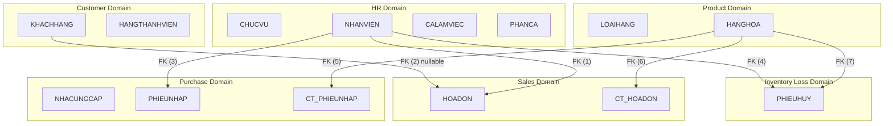
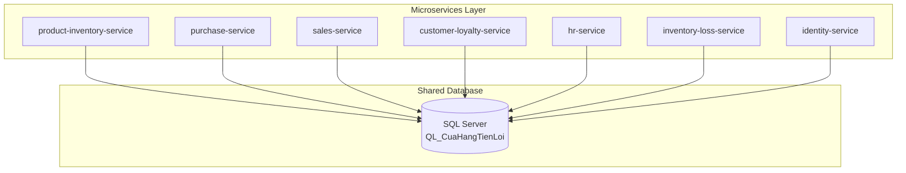
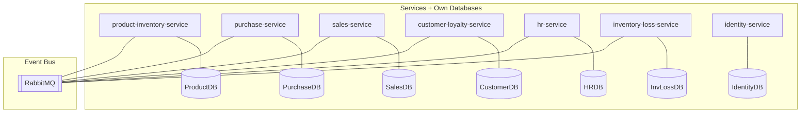
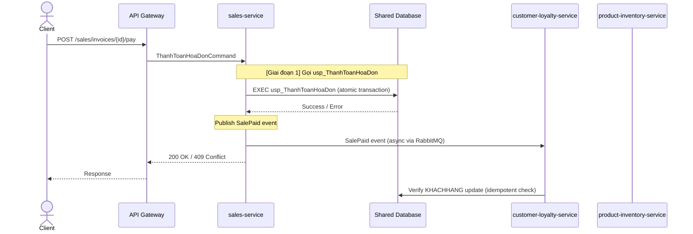
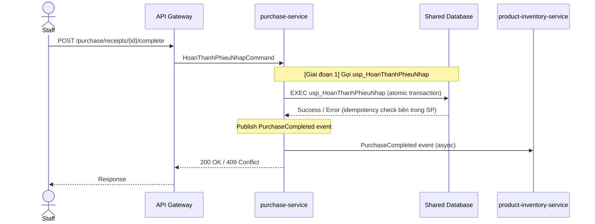

# SERVICE_DATABASE_OWNERSHIP.md

## Phân Quyền Sở Hữu Database Theo Service — QL_CuaHangTienLoi

> **Evidence Classification:**
>
> - `[VERIFIED]` — Xác minh từ SQL script / source code
> - `[USER-PROVIDED]` — Từ tài liệu nghiệp vụ, chưa xác minh
> - `[ASSUMPTION]` — Giả định phục vụ phân tích
> - `[PROPOSAL]` — Đề xuất cần phê duyệt

> [!IMPORTANT]
> Tài liệu này định nghĩa **ai được ghi vào bảng nào**. Vi phạm quy tắc ownership là lỗi kiến trúc nghiêm trọng, phải được phát hiện trong code review.

---

## 1. Bảng Ownership Tổng Quan

| Service                     | Bảng Sở Hữu (Write Access)          | Bảng Đọc Cross-Domain                                       | Ghi chú                         |
| --------------------------- | ----------------------------------- | ----------------------------------------------------------- | ------------------------------- |
| `product-inventory-service` | LOAIHANG, HANGHOA                   | —                                                           | Source of Truth cho tồn kho     |
| `purchase-service`          | NHACUNGCAP, PHIEUNHAP, CT_PHIEUNHAP | HANGHOA (read-only), NHANVIEN (read ref)                    | Gọi `usp_HoanThanhPhieuNhap`    |
| `sales-service`             | HOADON, CT_HOADON                   | HANGHOA (read stock), KHACHHANG (read), NHANVIEN (read ref) | Gọi `usp_ThanhToanHoaDon`       |
| `customer-loyalty-service`  | KHACHHANG, HANGTHANHVIEN            | —                                                           | Nhận event từ sales-service     |
| `hr-service`                | CHUCVU, NHANVIEN, CALAMVIEC, PHANCA | HOADON (read for salary report)                             | Sở hữu bảng được ref nhiều nhất |
| `inventory-loss-service`    | PHIEUHUY                            | HANGHOA (read to check stock), NHANVIEN (read ref)          | Phát command StockOutRequested  |
| `identity-service`          | ⚠️ TAIKHOAN (chưa tồn tại)          | NHANVIEN (tham chiếu để lấy MaChucVu)                       | [PROPOSAL] Cần tạo bảng mới     |
| `api-gateway`               | —                                   | —                                                           | Không sở hữu bảng               |

> [!WARNING]
> `[PROPOSAL]` `identity-service` hiện **không có bảng sở hữu** trong database. Cần quyết định kiến trúc trước khi implement (xem ADR-003 trong MICROSERVICES_DESIGN.md).

---

## 2. Chi Tiết Ownership Từng Bảng

| Bảng          | Service Sở Hữu              | Service Được Đọc                                                          | Cơ chế Đọc Cross-Domain          |
| ------------- | --------------------------- | ------------------------------------------------------------------------- | -------------------------------- |
| LOAIHANG      | `product-inventory-service` | purchase-service, sales-service                                           | API call hoặc Shared DB read     |
| HANGHOA       | `product-inventory-service` | purchase-service, sales-service, inventory-loss-service                   | API call hoặc Shared DB read     |
| NHACUNGCAP    | `purchase-service`          | —                                                                         | —                                |
| PHIEUNHAP     | `purchase-service`          | —                                                                         | —                                |
| CT_PHIEUNHAP  | `purchase-service`          | —                                                                         | —                                |
| HOADON        | `sales-service`             | hr-service (salary report)                                                | Event hoặc Shared DB read        |
| CT_HOADON     | `sales-service`             | —                                                                         | —                                |
| KHACHHANG     | `customer-loyalty-service`  | sales-service                                                             | API call hoặc Shared DB read     |
| HANGTHANHVIEN | `customer-loyalty-service`  | sales-service                                                             | API call hoặc Shared DB read     |
| CHUCVU        | `hr-service`                | identity-service                                                          | API call hoặc Shared DB read     |
| NHANVIEN      | `hr-service`                | sales-service, purchase-service, inventory-loss-service, identity-service | API call hoặc Shared DB read     |
| CALAMVIEC     | `hr-service`                | —                                                                         | —                                |
| PHANCA        | `hr-service`                | —                                                                         | —                                |
| PHIEUHUY      | `inventory-loss-service`    | —                                                                         | —                                |
| TAIKHOAN      | `identity-service`          | —                                                                         | **[PROPOSAL]** Bảng chưa tồn tại |

---

## 3. Cross-Domain FK Matrix

> [!NOTE]
> Matrix này thể hiện tất cả Foreign Key vượt qua ranh giới domain. Đây là rào cản chính để tách database vật lý trong tương lai.

### 3.1 FK Matrix Chi Tiết

| #   | Bảng Nguồn (Source) | Cột FK      | Bảng Đích (Target) | Source Domain  | Target Domain | Loại Coupling                            |
| --- | ------------------- | ----------- | ------------------ | -------------- | ------------- | ---------------------------------------- |
| 1   | HOADON              | MaNhanVien  | NHANVIEN           | Sales          | HR            | Reference (không thay đổi thường xuyên)  |
| 2   | HOADON              | MaKhachHang | KHACHHANG          | Sales          | Customer      | Nullable — Quan trọng cho business logic |
| 3   | PHIEUNHAP           | MaNhanVien  | NHANVIEN           | Purchase       | HR            | Reference                                |
| 4   | PHIEUHUY            | MaNhanVien  | NHANVIEN           | Inventory Loss | HR            | Reference                                |
| 5   | CT_PHIEUNHAP        | MaHang      | HANGHOA            | Purchase       | Product       | Cần validate stock                       |
| 6   | CT_HOADON           | MaHang      | HANGHOA            | Sales          | Product       | Cần check stock khi bán                  |
| 7   | PHIEUHUY            | MaHang      | HANGHOA            | Inventory Loss | Product       | Cần check stock khi hủy                  |

### 3.2 Heatmap Coupling Giữa Các Domain



### 3.3 Phân Tích Tác Động Khi Tách Database

| Cross-Domain FK        | Chiến lược thay thế khi tách DB                          | Complexity | Risk       |
| ---------------------- | -------------------------------------------------------- | ---------- | ---------- |
| HOADON → NHANVIEN      | Lưu MaNhanVien như reference ID, không enforce DB FK     | Thấp       | Thấp       |
| HOADON → KHACHHANG     | API call hoặc Saga Pattern, denormalize CustomerSnapshot | Cao        | Cao        |
| PHIEUNHAP → NHANVIEN   | Lưu reference ID                                         | Thấp       | Thấp       |
| PHIEUHUY → NHANVIEN    | Lưu reference ID                                         | Thấp       | Thấp       |
| CT_PHIEUNHAP → HANGHOA | Saga: StockInRequested Command                           | Trung bình | Trung bình |
| CT_HOADON → HANGHOA    | Saga: StockOutRequested Command                          | Cao        | Cao        |
| PHIEUHUY → HANGHOA     | Saga: StockOutRequested Command                          | Trung bình | Trung bình |

---

## 4. Phân Tích Ngưỡng Tách Database

### Giai Đoạn 1 (Hiện Tại): Shared Database Pattern `[PROPOSAL]`



**Lý do chọn Shared Database:**

- 7 FK xuyên domain — không thể tách ngay mà không phá vỡ referential integrity
- Độ phức tạp tách database cao, cần thời gian và test coverage trước
- 2 Stored Procedure phức tạp xuyên domain vẫn tồn tại
- Ưu tiên: Tốc độ phát triển ban đầu quan trọng hơn isolation

**Ràng buộc bắt buộc ngay cả khi dùng Shared Database:**

- Mỗi service chỉ **ghi** vào bảng mình sở hữu
- Đọc cross-domain được phép nhưng phải qua layer tường minh (không raw SQL join từ service khác)
- Không tạo FK mới xuyên domain

### Giai Đoạn 2 (Tương Lai): Database per Service `[PROPOSAL — Pending Approval]`



**Điều kiện để chuyển sang Giai Đoạn 2:**

1. Tất cả FK xuyên domain phải được xử lý bằng application-level reference
2. 2 Stored Procedure phải được migrate hoàn toàn vào service code
3. Saga Pattern cho cross-service transaction đã được implement và test
4. Outbox/Inbox Pattern đã được implement
5. Test coverage >= 80% cho tất cả transaction scenario

---

## 5. Quy Tắc Ownership Bắt Buộc

> [!CAUTION]
> Vi phạm các quy tắc sau là **lỗi kiến trúc nghiêm trọng** và phải bị block trong code review.

### 5.1 Quy Tắc Vàng

```
1. Chỉ service sở hữu mới được WRITE (INSERT/UPDATE/DELETE) vào bảng của mình
2. Service khác phải gọi API của service sở hữu để thay đổi data
3. Không tạo bản sao (replica) bảng nghiệp vụ để né FK — phải dùng event-driven
4. Không để hai service ghi vào cùng một bảng
5. Stored Procedure chỉ được gọi từ service được chỉ định
```

### 5.2 Stored Procedure Call Authorization

| SP                       | Service được phép gọi         | Service bị cấm gọi  |
| ------------------------ | ----------------------------- | ------------------- |
| `usp_ThanhToanHoaDon`    | `sales-service` (DUY NHẤT)    | Tất cả service khác |
| `usp_HoanThanhPhieuNhap` | `purchase-service` (DUY NHẤT) | Tất cả service khác |

---

## 6. Cross-Service Transaction Analysis

### 6.1 Thanh Toán Hoá Đơn (Critical) `[USER-PROVIDED]`



**Phân tích ranh giới transaction:**

- **Giai đoạn 1**: `usp_ThanhToanHoaDon` xử lý toàn bộ trong 1 DB transaction (bao gồm cả KHACHHANG update). `sales-service` là sole caller.
- **Giai đoạn 2 (PROPOSAL)**: Saga Pattern — `sales-service` tạo HĐ + publish `SalePaymentRequested` → `product-inventory-service` xử lý stock out → `customer-loyalty-service` xử lý điểm

**Risk:** `[RISK]` SP ghi vào 3 domain. Nếu `customer-loyalty-service` và SP cùng cập nhật KHACHHANG, sẽ conflict.

**Chiến lược tạm thời:** Trong Giai đoạn 1, `customer-loyalty-service` **không** được ghi vào KHACHHANG từ event handler — để SP lo toàn bộ. Event `SalePaid` chỉ dùng để sync cache/notification.

### 6.2 Hoàn Thành Phiếu Nhập (Critical) `[USER-PROVIDED]`



**Risk:** `[RISK]` SP ghi vào `HANGHOA.SoLuongTon` — bảng thuộc `product-inventory-service`.

**Chiến lược tạm thời:** Trong Giai đoạn 1, `purchase-service` là caller của SP — chấp nhận vi phạm ownership boundary tạm thời, được đánh dấu là Technical Debt cần giải quyết trước Giai đoạn 2.

### 6.3 Hủy Hàng `[ASSUMPTION]`

| Thuộc tính       | Chi tiết                                                                                             |
| ---------------- | ---------------------------------------------------------------------------------------------------- |
| Service tham gia | `inventory-loss-service`, `product-inventory-service`                                                |
| Command phát ra  | `InventoryLossStockOutRequested`                                                                     |
| Chiến lược       | `inventory-loss-service` tạo PHIEUHUY → publish command → `product-inventory-service` trừ SoLuongTon |

---

## 7. Event & Command Ownership

### 7.1 Commands (Ai phát — Ai nhận)

| Command                          | Publisher                                 | Consumer                    | Mô tả                 |
| -------------------------------- | ----------------------------------------- | --------------------------- | --------------------- |
| `StockInRequested`               | `purchase-service`                        | `product-inventory-service` | Yêu cầu cộng tồn kho  |
| `StockOutRequested`              | `sales-service`, `inventory-loss-service` | `product-inventory-service` | Yêu cầu trừ tồn kho   |
| `UpdateCustomerLoyaltyRequested` | `sales-service`                           | `customer-loyalty-service`  | Yêu cầu cập nhật điểm |

### 7.2 Domain Events (Ai phát — Ai lắng nghe)

| Event                   | Publisher                   | Consumer(s)                               | Mô tả                         |
| ----------------------- | --------------------------- | ----------------------------------------- | ----------------------------- |
| `PurchaseCompleted`     | `purchase-service`          | `product-inventory-service`               | Phiếu nhập hoàn thành         |
| `SalePaid`              | `sales-service`             | `customer-loyalty-service`, `hr-service`  | Hoá đơn được thanh toán       |
| `StockInCompleted`      | `product-inventory-service` | `purchase-service`                        | Tồn kho đã được cộng          |
| `StockOutCompleted`     | `product-inventory-service` | `sales-service`, `inventory-loss-service` | Tồn kho đã được trừ           |
| `CustomerPointsUpdated` | `customer-loyalty-service`  | —                                         | Điểm khách hàng được cập nhật |
| `LoyaltyTierUpgraded`   | `customer-loyalty-service`  | —                                         | Hạng thành viên được nâng     |
| `InventoryLossCreated`  | `inventory-loss-service`    | `product-inventory-service`               | Phiếu hủy được tạo            |

---

## 8. Technical Debt Tracker

> Các vi phạm ownership tạm thời trong Giai đoạn 1 cần được giải quyết trước Giai đoạn 2:

| #      | Vi Phạm                                  | Service Vi Phạm           | Bảng Bị Vi Phạm                                 | Kế Hoạch Giải Quyết                       |
| ------ | ---------------------------------------- | ------------------------- | ----------------------------------------------- | ----------------------------------------- |
| TD-001 | `usp_ThanhToanHoaDon` ghi vào KHACHHANG  | `sales-service` caller    | KHACHHANG (sở hữu bởi customer-loyalty-service) | Migrate logic sang Saga Pattern           |
| TD-002 | `usp_ThanhToanHoaDon` ghi vào HANGHOA    | `sales-service` caller    | HANGHOA (sở hữu bởi product-inventory-service)  | Migrate logic sang StockOut Command       |
| TD-003 | `usp_HoanThanhPhieuNhap` ghi vào HANGHOA | `purchase-service` caller | HANGHOA (sở hữu bởi product-inventory-service)  | Migrate logic sang StockIn Command        |
| TD-004 | `identity-service` không có bảng sở hữu  | `identity-service`        | TAIKHOAN (chưa tạo)                             | Tạo bảng TAIKHOAN (sau phê duyệt ADR-003) |

---

_Document generated: Stage 1 Architecture Analysis_
_Status: DRAFT — Pending Review_
_Author: Senior Software Architect (AI-assisted)_
