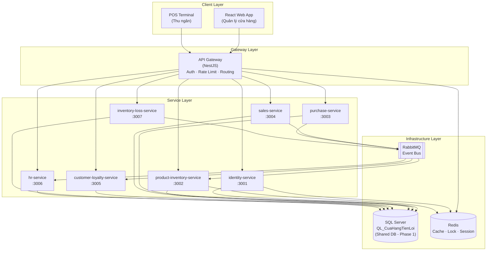
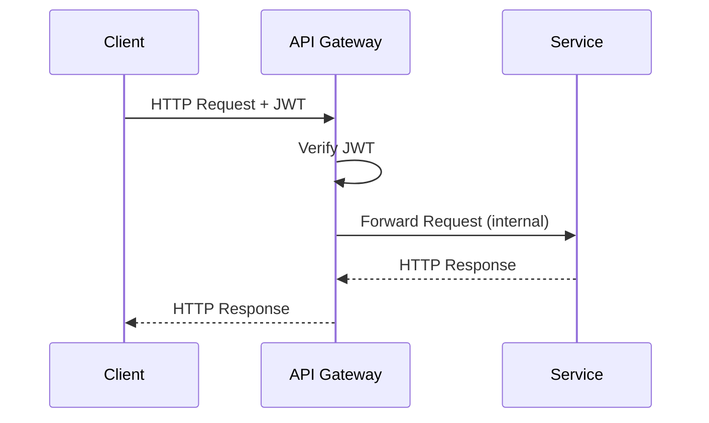
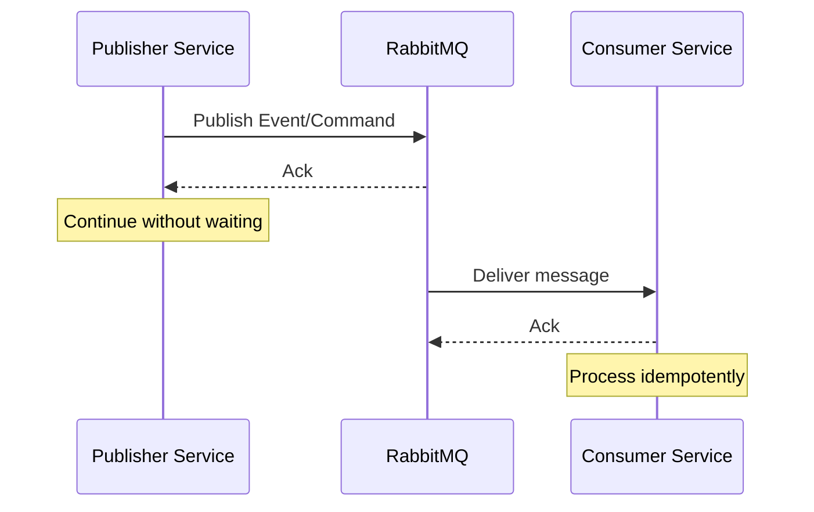
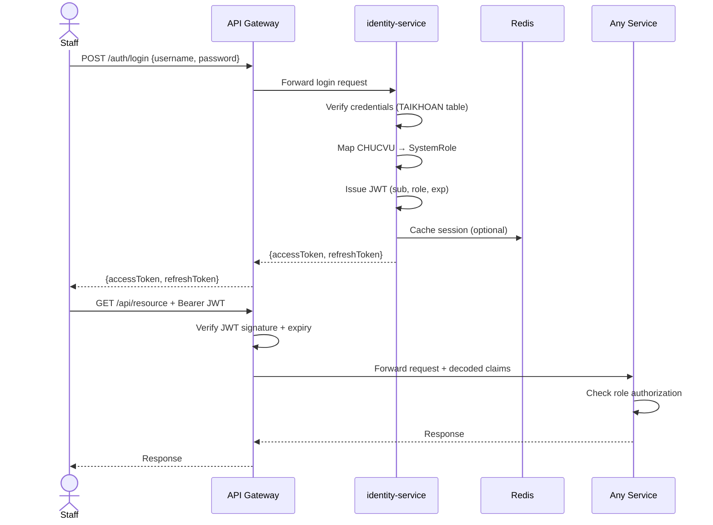
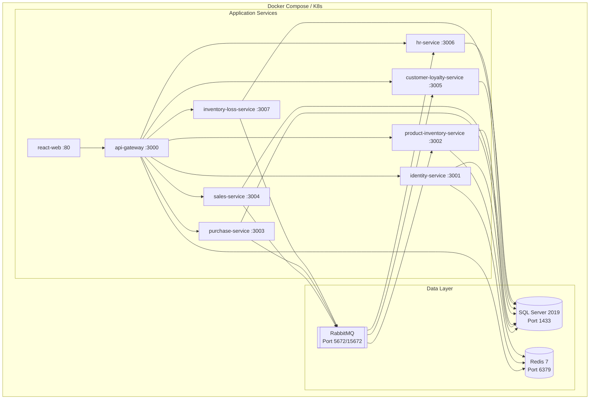

# SYSTEM_ARCHITECTURE.md

## Kiến Trúc Hệ Thống — QL_CuaHangTienLoi

> **Evidence Classification:**
>
> - `[VERIFIED]` — Xác minh từ SQL script / source code
> - `[USER-PROVIDED]` — Từ tài liệu nghiệp vụ, chưa xác minh
> - `[ASSUMPTION]` — Giả định phục vụ phân tích
> - `[PROPOSAL]` — Đề xuất cần phê duyệt

---

## 1. Executive Summary

| Thuộc tính         | Giá trị                                          | Evidence        |
| ------------------ | ------------------------------------------------ | --------------- |
| Tên hệ thống       | QL_CuaHangTienLoi                                | [USER-PROVIDED] |
| Loại kiến trúc     | Microservices-oriented (Shared Database Phase 1) | [PROPOSAL]      |
| Giai đoạn hiện tại | Monorepo Scaffold — Shared Database              | [PROPOSAL]      |
| Database           | Microsoft SQL Server                             | [USER-PROVIDED] |
| Backend Framework  | NestJS (TypeScript)                              | [ASSUMPTION]    |
| Frontend           | React                                            | [ASSUMPTION]    |
| Event Bus          | RabbitMQ                                         | [PROPOSAL]      |
| Cache              | Redis                                            | [PROPOSAL]      |
| Containerization   | Docker                                           | [PROPOSAL]      |
| Services count     | 8 (7 backend + 1 gateway)                        | [USER-PROVIDED] |

**Triết lý kiến trúc:**

> Bắt đầu với Microservices logical separation + Shared Database. Tiến hóa dần sang Database per Service khi business rules và cross-domain transactions được kiểm soát hoàn toàn qua code.

---

## 2. Architecture Decision: Monolith vs Microservices

### 2.1 Đánh Giá Theo Tiêu Chí

| Tiêu Chí                | Monolithic    | Modular Monolith | Microservices (Chọn)    | Evidence                                 |
| ----------------------- | ------------- | ---------------- | ----------------------- | ---------------------------------------- |
| Quy mô dự án            | Phù hợp       | Phù hợp          | Over-engineered nếu nhỏ | [USER-PROVIDED] không đề cập số cửa hàng |
| Domain complexity       | Quản lý được  | Tốt              | Tốt nhất                | Cao — 14 bảng, 6 domain rõ ràng          |
| Transaction complexity  | Đơn giản nhất | Trung bình       | Phức tạp nhất           | [RISK] Cross-domain transactions         |
| Team independence       | Không         | Trung bình       | Cao nhất                | Team size: [UNKNOWN]                     |
| Deployment independence | Không         | Không            | Cao nhất                | [UNKNOWN]                                |
| Tech debt hiện tại      | Thấp          | Thấp             | Trung bình              | 2 SP xuyên domain                        |

### 2.2 Lý Do Chọn Microservices `[PROPOSAL]`

1. **Domain boundaries rõ ràng**: 6 domain tự nhiên (Product, Purchase, Sales, Customer, HR, InventoryLoss)
2. **Yêu cầu của dự án**: [USER-PROVIDED] — Kiến trúc Microservices đã được chỉ định
3. **Monorepo giảm overhead**: Giữ nguyên DX tốt khi vẫn có boundary rõ ràng
4. **Shared Database giảm risk giai đoạn đầu**: Không phải giải quyết distributed transaction ngay

### 2.3 Rủi Ro Đã Biết và Chiến Lược Giảm Thiểu

| Rủi ro                             | Mức độ     | Chiến lược                            |
| ---------------------------------- | ---------- | ------------------------------------- |
| Cross-domain transactions phức tạp | Cao        | Shared Database giai đoạn 1, Saga sau |
| Race condition trên SoLuongTon     | Cao        | Pessimistic locking (SELECT UPDLOCK)  |
| Stored Procedure coupling          | Trung bình | Designated caller pattern             |
| Không có bảng TAIKHOAN             | Trung bình | ADR-003 pending approval              |
| Over-engineering cho quy mô nhỏ    | Thấp       | Monorepo giảm thiểu friction          |

---

## 3. High-Level Architecture



---

## 4. Services và Trách Nhiệm

### 4.1 api-gateway

| Thuộc tính  | Chi tiết                                                   | Evidence   |
| ----------- | ---------------------------------------------------------- | ---------- |
| Port        | 3000                                                       | [PROPOSAL] |
| Trách nhiệm | Routing, Auth verification, Rate limiting, SSL termination | [PROPOSAL] |
| Database    | Không                                                      | —          |
| Technology  | NestJS + `@nestjs/gateway` hoặc custom                     | [PROPOSAL] |

**Responsibilities:**

- Xác thực JWT token (verify, không issue)
- Route request đến đúng service
- Rate limiting per user/IP
- Request/Response logging
- CORS handling

---

### 4.2 identity-service

| Thuộc tính  | Chi tiết                                     | Evidence   |
| ----------- | -------------------------------------------- | ---------- |
| Port        | 3001                                         | [PROPOSAL] |
| Trách nhiệm | Authentication, JWT issuance, RBAC           | [PROPOSAL] |
| Database    | TAIKHOAN (chưa tồn tại), tham chiếu NHANVIEN | [PROPOSAL] |

> [!CAUTION]
> **[CRITICAL]** Database hiện tại không có bảng tài khoản đăng nhập. Identity service không thể implement cho đến khi ADR-003 được phê duyệt.

---

### 4.3 product-inventory-service

| Thuộc tính     | Chi tiết                                                | Evidence        |
| -------------- | ------------------------------------------------------- | --------------- |
| Port           | 3002                                                    | [PROPOSAL]      |
| Trách nhiệm    | Quản lý danh mục hàng hoá và tồn kho                    | [PROPOSAL]      |
| Database owned | LOAIHANG, HANGHOA                                       | [PROPOSAL]      |
| Critical path  | `SoLuongTon` — Source of Truth, nhiều service phụ thuộc | [USER-PROVIDED] |

**Key Design Points:**

- `SoLuongTon` là điểm nóng — phải có distributed lock (Redis) khi cập nhật
- Tiếp nhận Commands: `StockInRequested`, `StockOutRequested` từ event bus
- Publish Events: `StockInCompleted`, `StockOutCompleted`

---

### 4.4 purchase-service

| Thuộc tính     | Chi tiết                                | Evidence   |
| -------------- | --------------------------------------- | ---------- |
| Port           | 3003                                    | [PROPOSAL] |
| Trách nhiệm    | Quản lý nhà cung cấp và phiếu nhập hàng | [PROPOSAL] |
| Database owned | NHACUNGCAP, PHIEUNHAP, CT_PHIEUNHAP     | [PROPOSAL] |
| SP authorized  | `usp_HoanThanhPhieuNhap` (DUY NHẤT)     | [PROPOSAL] |

---

### 4.5 sales-service

| Thuộc tính         | Chi tiết                                   | Evidence     |
| ------------------ | ------------------------------------------ | ------------ |
| Port               | 3004                                       | [PROPOSAL]   |
| Trách nhiệm        | Quản lý hoá đơn bán hàng, xử lý thanh toán | [PROPOSAL]   |
| Database owned     | HOADON, CT_HOADON                          | [PROPOSAL]   |
| SP authorized      | `usp_ThanhToanHoaDon` (DUY NHẤT)           | [PROPOSAL]   |
| Cross-domain reads | HANGHOA (stock check), KHACHHANG, NHANVIEN | [ASSUMPTION] |

---

### 4.6 customer-loyalty-service

| Thuộc tính     | Chi tiết                                           | Evidence   |
| -------------- | -------------------------------------------------- | ---------- |
| Port           | 3005                                               | [PROPOSAL] |
| Trách nhiệm    | Quản lý khách hàng, điểm tích luỹ, hạng thành viên | [PROPOSAL] |
| Database owned | KHACHHANG, HANGTHANHVIEN                           | [PROPOSAL] |

**Ghi chú giai đoạn 1:** Trong Giai đoạn 1, `usp_ThanhToanHoaDon` đã cập nhật KHACHHANG trực tiếp trong DB transaction. Service này không được ghi vào KHACHHANG từ event handler để tránh double-write. Chỉ nhận event để sync cache.

---

### 4.7 hr-service

| Thuộc tính         | Chi tiết                                  | Evidence     |
| ------------------ | ----------------------------------------- | ------------ |
| Port               | 3006                                      | [PROPOSAL]   |
| Trách nhiệm        | Quản lý nhân viên, ca làm việc, chấm công | [PROPOSAL]   |
| Database owned     | CHUCVU, NHANVIEN, CALAMVIEC, PHANCA       | [PROPOSAL]   |
| Cross-domain reads | HOADON (cho salary report)                | [ASSUMPTION] |

---

### 4.8 inventory-loss-service

| Thuộc tính     | Chi tiết                                 | Evidence   |
| -------------- | ---------------------------------------- | ---------- |
| Port           | 3007                                     | [PROPOSAL] |
| Trách nhiệm    | Quản lý phiếu hủy hàng, báo cáo tổn thất | [PROPOSAL] |
| Database owned | PHIEUHUY                                 | [PROPOSAL] |
| Commands sent  | `StockOutRequested` (khi hủy hàng)       | [PROPOSAL] |

---

## 5. Communication Patterns

### 5.1 Synchronous Communication (REST)



**Sử dụng cho:**

- CRUD operations
- Query operations
- Real-time validation (stock check khi tạo đơn hàng)

### 5.2 Asynchronous Communication (RabbitMQ)



**Sử dụng cho:**

- Domain events (SalePaid, PurchaseCompleted)
- Commands (StockInRequested, StockOutRequested)
- Notifications

**Quy tắc messaging:**

- Mọi consumer phải xử lý idempotently (at-least-once delivery)
- Message phải có correlation ID
- Dead Letter Queue cho messages thất bại

---

## 6. Transaction Matrix

### 6.1 Thanh Toán Hoá Đơn

| Thuộc tính           | Chi tiết                                                           | Evidence        |
| -------------------- | ------------------------------------------------------------------ | --------------- |
| Services tham gia    | sales-service, product-inventory-service, customer-loyalty-service | [USER-PROVIDED] |
| Transaction boundary | 1 DB transaction (Giai đoạn 1 qua SP)                              | [USER-PROVIDED] |
| Idempotency          | Kiểm tra TrangThai = "Mới tạo"                                     | [USER-PROVIDED] |
| Concurrency          | `SELECT WITH UPDLOCK` trong SP                                     | [ASSUMPTION]    |

**Giai đoạn 1 (Hiện tại):**

```
sales-service → EXEC usp_ThanhToanHoaDon → Atomic DB Transaction
              → Publish SalePaid event (fire-and-forget)
```

**Giai đoạn 2 (PROPOSAL — Saga Choreography):**

```
sales-service: CREATE HOADON, Publish SalePaymentRequested
product-inventory-service: ON SalePaymentRequested → StockOut → Publish StockOutCompleted
customer-loyalty-service: ON StockOutCompleted → Update Points → Publish CustomerPointsUpdated
sales-service: ON CustomerPointsUpdated → Mark HOADON = "Đã thanh toán"
[Compensation] ON StockOutFailed → sales-service: Cancel HOADON
```

### 6.2 Hoàn Thành Phiếu Nhập

| Thuộc tính           | Chi tiết                                    | Evidence        |
| -------------------- | ------------------------------------------- | --------------- |
| Services tham gia    | purchase-service, product-inventory-service | [USER-PROVIDED] |
| Transaction boundary | 1 DB transaction (Giai đoạn 1 qua SP)       | [USER-PROVIDED] |
| Idempotency          | Kiểm tra TrangThai phiếu trước khi gọi SP   | [USER-PROVIDED] |

**Giai đoạn 2 (PROPOSAL — Outbox Pattern):**

```
purchase-service: Mark PHIEUNHAP = "Đang xử lý", Write to OUTBOX table
Outbox relay: Read OUTBOX → Publish StockInRequested to RabbitMQ
product-inventory-service: ON StockInRequested → Update SoLuongTon → Publish StockInCompleted
purchase-service: ON StockInCompleted → Mark PHIEUNHAP = "Hoàn thành", Delete from OUTBOX
```

### 6.3 Hủy Hàng

| Thuộc tính        | Chi tiết                                          | Evidence     |
| ----------------- | ------------------------------------------------- | ------------ |
| Services tham gia | inventory-loss-service, product-inventory-service | [ASSUMPTION] |
| Command           | `InventoryLossStockOutRequested`                  | [PROPOSAL]   |

### 6.4 Cập Nhật Tồn Kho Trực Tiếp

| Thuộc tính      | Chi tiết                               |
| --------------- | -------------------------------------- |
| Owner           | `product-inventory-service` (DUY NHẤT) |
| Commands nhận   | StockInRequested, StockOutRequested    |
| Concurrency     | Redis Distributed Lock + SQL UPDLOCK   |
| Idempotency key | Bắt buộc trong mọi Command             |

### 6.5 Cập Nhật Điểm Thành Viên

| Thuộc tính    | Chi tiết                               | Evidence        |
| ------------- | -------------------------------------- | --------------- |
| Owner         | `customer-loyalty-service`             | [PROPOSAL]      |
| Trigger       | SalePaid event từ sales-service        | [PROPOSAL]      |
| Điều kiện     | Chỉ khi HOADON.MaKhachHang IS NOT NULL | [USER-PROVIDED] |
| Business Rule | 1 điểm = 1.000 VNĐ giảm giá            | [USER-PROVIDED] |

---

## 7. Event Catalog

### 7.1 Commands (Intent to do something)

| Command                | Publisher                             | Consumer                  | Payload (dự kiến)                                         | Evidence   |
| ---------------------- | ------------------------------------- | ------------------------- | --------------------------------------------------------- | ---------- |
| `StockInRequested`     | purchase-service                      | product-inventory-service | `{idempotencyKey, maHang, soLuong, maPhieuNhap}`          | [PROPOSAL] |
| `StockOutRequested`    | sales-service, inventory-loss-service | product-inventory-service | `{idempotencyKey, maHang, soLuong, sourceId, sourceType}` | [PROPOSAL] |
| `SalePaymentRequested` | sales-service                         | product-inventory-service | `{idempotencyKey, maHoaDon, items[]}`                     | [PROPOSAL] |

### 7.2 Domain Events (Something happened)

| Event                    | Publisher                 | Consumer(s)                           | Payload (dự kiến)                               | Evidence   |
| ------------------------ | ------------------------- | ------------------------------------- | ----------------------------------------------- | ---------- |
| `PurchaseCompleted`      | purchase-service          | product-inventory-service             | `{maPhieuNhap, items[]}`                        | [PROPOSAL] |
| `SalePaid`               | sales-service             | customer-loyalty-service, hr-service  | `{maHoaDon, maKhachHang, tongTien, maNhanVien}` | [PROPOSAL] |
| `StockInCompleted`       | product-inventory-service | purchase-service                      | `{maPhieuNhap, idempotencyKey}`                 | [PROPOSAL] |
| `StockOutCompleted`      | product-inventory-service | sales-service, inventory-loss-service | `{sourceId, sourceType, idempotencyKey}`        | [PROPOSAL] |
| `CustomerPointsUpdated`  | customer-loyalty-service  | —                                     | `{maKhachHang, diemMoi, tongChiTieu}`           | [PROPOSAL] |
| `LoyaltyTierUpgraded`    | customer-loyalty-service  | —                                     | `{maKhachHang, hangMoi, hangCu}`                | [PROPOSAL] |
| `InventoryLossCreated`   | inventory-loss-service    | product-inventory-service             | `{maPhieuHuy, maHang, soLuongHuy}`              | [PROPOSAL] |
| `InventoryLossCompleted` | inventory-loss-service    | —                                     | `{maPhieuHuy}`                                  | [PROPOSAL] |

---

## 8. Security Architecture

### 8.1 Authentication Flow



### 8.2 RBAC Design `[PROPOSAL]`

> [!NOTE]
> CHUCVU là chức vụ nghiệp vụ HR. Cần mapping sang System Roles để RBAC hoạt động.

| System Role  | CHUCVU tương ứng (giả định) | Quyền hạn                         |
| ------------ | --------------------------- | --------------------------------- |
| `ADMIN`      | Quản lý cửa hàng            | Full access                       |
| `CASHIER`    | Thu ngân                    | Sales, Customer read              |
| `WAREHOUSE`  | Nhân viên kho               | Purchase, Inventory, Product read |
| `HR_MANAGER` | Quản lý nhân sự             | HR full, Reports read             |
| `VIEWER`     | —                           | Read-only                         |

> [!WARNING]
> Mapping CHUCVU → SystemRole chưa được xác nhận. Cần xác minh danh sách chức vụ thực tế trước khi implement.

### 8.3 JWT Claims Structure `[PROPOSAL]`

```json
{
  "sub": "NV001",
  "maNhanVien": "NV001",
  "tenNhanVien": "Nguyễn Văn A",
  "role": "CASHIER",
  "maChucVu": "CV001",
  "iat": 1700000000,
  "exp": 1700086400
}
```

---

## 9. Infrastructure Architecture

### 9.1 Tổng Quan Infrastructure `[PROPOSAL]`



### 9.2 Redis Usage `[PROPOSAL]`

| Use Case                        | Pattern                | Service                       |
| ------------------------------- | ---------------------- | ----------------------------- |
| JWT blacklist (logout)          | Key-Value with TTL     | identity-service, api-gateway |
| Distributed lock (stock update) | `SET NX PX`            | product-inventory-service     |
| Rate limiting                   | Sliding Window Counter | api-gateway                   |
| Product cache                   | Cache-Aside            | product-inventory-service     |
| Session data                    | Hash                   | identity-service              |

### 9.3 SQL Server Configuration `[PROPOSAL]`

| Setting         | Value               | Lý do                                     |
| --------------- | ------------------- | ----------------------------------------- |
| Isolation Level | READ COMMITTED      | Default, đủ cho hầu hết operations        |
| SP Locking      | SELECT WITH UPDLOCK | Prevent race condition khi update tồn kho |
| Connection Pool | 10-50 per service   | `[ASSUMPTION]` dựa trên load ước tính     |
| Collation       | `Vietnamese_CI_AS`  | Hỗ trợ tiếng Việt                         |

---

## 10. Monorepo Structure `[PROPOSAL]`

```
AH-Center-Shop/
├── apps/
│   ├── api-gateway/            # NestJS API Gateway
│   ├── identity-service/       # NestJS
│   ├── product-inventory-service/ # NestJS
│   ├── purchase-service/       # NestJS
│   ├── sales-service/          # NestJS
│   ├── customer-loyalty-service/ # NestJS
│   ├── hr-service/             # NestJS
│   ├── inventory-loss-service/ # NestJS
│   └── web/                   # React App
├── libs/
│   ├── shared-types/          # DTOs, interfaces, enums
│   ├── shared-events/         # Event/Command definitions
│   ├── shared-auth/           # JWT utilities
│   └── database/              # TypeORM entities (shared)
├── docs/                      # Architecture documents (này)
├── docker-compose.yml
├── nx.json                    # [PROPOSAL] Nx monorepo tool
└── package.json
```

> [!NOTE]
> Monorepo tool (Nx vs Turborepo) chưa được quyết định — xem ADR-002 trong MICROSERVICES_DESIGN.md.

---

## 11. Quality Attributes

| Attribute       | Target                                      | Strategy                           | Evidence     |
| --------------- | ------------------------------------------- | ---------------------------------- | ------------ |
| Availability    | 99.9%                                       | Stateless services + Redis session | [PROPOSAL]   |
| Consistency     | Eventual (events), Strong (SP transactions) | Shared DB giai đoạn 1              | [PROPOSAL]   |
| Scalability     | Horizontal per service                      | Docker/K8s                         | [PROPOSAL]   |
| Security        | JWT + RBAC                                  | API Gateway validation             | [PROPOSAL]   |
| Observability   | Centralized logging + tracing               | [UNKNOWN] — chưa được chỉ định     | [ASSUMPTION] |
| Maintainability | Monorepo + shared libs                      | Nx code generation                 | [PROPOSAL]   |

---

## 12. UNKNOWNS & Open Questions

| Ưu tiên | Unknown                                       | Cần từ                     | Tác động                   |
| ------- | --------------------------------------------- | -------------------------- | -------------------------- |
| P0      | SQL script đầy đủ                             | Database admin / developer | Tất cả                     |
| P0      | Body SP usp_ThanhToanHoaDon                   | Database admin             | Transaction design         |
| P0      | Body SP usp_HoanThanhPhieuNhap                | Database admin             | Transaction design         |
| P1      | Số cửa hàng dự kiến                           | Business owner             | Scale architecture         |
| P1      | Concurrent users dự kiến                      | Business owner             | Infrastructure sizing      |
| P1      | Team size                                     | Project manager            | Monorepo tool selection    |
| P1      | Approval: ADR-003 (TAIKHOAN)                  | Architect + Business       | Identity service unblocked |
| P1      | Approval: ADR-002 (Monorepo tool)             | Architect + Team           | Project setup              |
| P2      | Công thức tích điểm chính xác                 | Business owner             | customer-loyalty logic     |
| P2      | Danh sách chức vụ thực tế                     | HR                         | RBAC mapping               |
| P2      | Observability stack (Jaeger, ELK…)            | DevOps                     | Monitoring design          |
| P3      | CI/CD platform (GitHub Actions, Cloud Build…) | DevOps                     | Pipeline setup             |

---

_Document generated: Stage 1 Architecture Analysis_
_Status: DRAFT — Pending stakeholder review_
_Author: Senior Software Architect (AI-assisted)_
